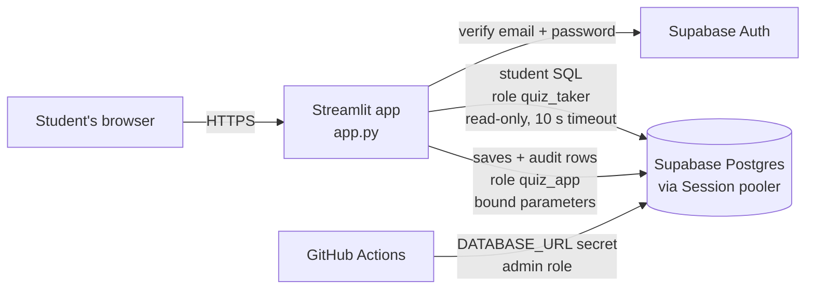

# 🛒 Olist E-commerce SQL Quiz

A 20-point SQL quiz that runs against a **live, hosted PostgreSQL database** — the same
Olist e-commerce tables (`customers`, `orders`, `order_items`, `products`) used by the
IDS 706 [SQL Practice Lab](https://sql-practice-lab-ids706.vercel.app/).
Students sign in, pick a question, type SQL, run it, and see the real result table plus
an instant check against the expected result.

**Quiz site:** `https://YOUR-APP-NAME.streamlit.app`  ← *replace after deploying (step 5)*

| Requirement | Where it lives |
|---|---|
| 1. Hosted PostgreSQL | Supabase (free tier) holding the Olist tables, reached over the **Session pooler** with `sslmode=require`. The data ships in this repo and GitHub Actions loads it automatically. |
| 2. Authentication | Supabase Auth (email + password). Signed-out users can read questions but **cannot run SQL or save** |
| 3. GitHub Actions + Secrets | `.github/workflows/db-check.yml` sets up roles/grants and verifies the quiz using 3 GitHub Secrets |
| 4. 20-point SQL quiz | `quiz/questions.py` — 5 questions (3 + 4 + 5 + 4 + 4), each with expected SQL **and** expected result |
| Extra: parameterised queries | Every statement the app writes uses `%s` bind parameters (`quiz/db.py`, `scripts/*.py`) |
| Extra: audit log | `app.audit_log` records every sign-in, sign-out, query run, and save |
| Extra: integrity check | Taker role has no access to the log; log is append-only (trigger); SHA-256 hash chain verified in CI and in the app |

---

## 1. How it works



**Database layout**

| Schema | Tables | Who can do what |
|---|---|---|
| `public` | `customers`, `orders`, `order_items`, `products` (Olist, loaded once by Actions) | `quiz_taker`: SELECT only. Hidden from the Supabase Data API (RLS on, API roles revoked). |
| `app` (created by this project) | `quiz_submissions`, `audit_log` | `quiz_app`: SELECT + INSERT only. `quiz_taker`: **nothing** |

`app` is deliberately not `public`, so Supabase's Data API does not expose it to the anon/publishable key.

**Three database logins, least privilege:**

| Role | Used by | Can |
|---|---|---|
| `postgres` (admin) | GitHub Actions only (`DATABASE_URL` secret) | load Olist (first run), create roles, the `app` schema, grants |
| `quiz_app` | the web app | append submissions and audit rows, read them back |
| `quiz_taker` | the web app, **for student SQL only** | `SELECT` on the 4 Olist tables; read-only, always rolled back; 10 s timeout |

The student's SQL is the one thing that cannot be parameterised — it *is* the query. Safety comes from the
database, not from string checks: the app runs it as `DECLARE quiz_cursor CURSOR FOR <student SQL>`, which
Postgres accepts only for a single read query (so `SELECT 1; DELETE …` or `UPDATE …` are rejected by the server),
under a role that has no write privileges anyway. The cursor also lets the app fetch only the first 500 rows, so
`SELECT * FROM order_items` (112,650 rows) stays fast.

### Repository map

```
app.py                         Streamlit UI: sign in/up, questions, Run, Save, history
quiz/questions.py              the 5 questions, points, hint SQL, expected results
quiz/grading.py                result-set comparison (ignores column names; order only if required)
quiz/db.py                     query runner (quiz_taker) + parameterised writes (quiz_app)
sql/01_app_schema.sql          app schema: submissions, audit log, triggers, hash chain
sql/02_grants.sql              least-privilege grants
scripts/setup_db.py            idempotent setup: checks Olist tables, roles, SQL files, RLS policy
scripts/check_quiz.py          CI checks: hints vs live data, permissions, audit integrity
scripts/load_olist.py          loads data/olist/*.csv.gz into public.* if the tables don't exist yet
data/olist/                    the 4 Olist CSVs (gzipped, 19 MB) + license/attribution
.github/workflows/db-check.yml
.env.example                   template for local secrets (.env is git-ignored)
.streamlit/secrets.toml.example  template for the hosted app's secrets
```

---

## 2. Setup (about 20 minutes)

### Step 1 — Create a Supabase project (you don't load any data by hand)
1. Sign up at [supabase.com](https://supabase.com) (GitHub login works) → **New project**.
   Pick any name, **generate a database password and save it**, choose a region near you
   (e.g. *East US*), free plan. Wait ~2 minutes until the project is ready.
2. Click **Connect** (top of the project page) → **Session pooler**. Copy the URI:
   `postgresql://postgres.<project-ref>:[YOUR-PASSWORD]@aws-0-<region>.pooler.supabase.com:5432/postgres`
   (use the exact host shown; newer projects may say `aws-1-…`). Do **not** use the *Direct connection*.
3. Replace `[YOUR-PASSWORD]` with your database password and append `?sslmode=require`. URL-encode special
   characters in the password (`@` → `%40`, `#` → `%23`). This full string is your **`DATABASE_URL`**.
4. **Project Settings → API Keys**: copy the **Project URL** and the **publishable key** (`sb_publishable_…`;
   the legacy `anon` key also works) → **`SUPABASE_URL`**, **`SUPABASE_KEY`**. Never use the secret/`service_role` key here.
5. **Authentication → Sign In / Providers → Email**: enable Email. For a class quiz, turn **Confirm email** off so
   classmates can sign in immediately (Supabase's built-in email sender is heavily rate-limited). Or create users
   yourself under **Authentication → Users → Add user**.

The Olist tables are created by GitHub Actions in step 3 — the four CSVs are in `data/olist/`.

### Shortcut — generate every secret with one command
On your own computer, in the repo folder:
```bash
pip3 install -r requirements.txt      # optional; enables the connection test
python3 scripts/make_secrets.py
```
It asks for the database password and publishable key (hidden input), tests the connection, generates the two role
passwords, URL-encodes everything, writes `.env` and `.streamlit/secrets.toml` (both git-ignored), and — if the
GitHub `gh` CLI is installed — can upload the 3 Actions secrets for you. (Edit `PROJECT_REF` / `POOLER_HOST` at the
top of the script if you fork this for another project.) Steps 2–4 below are the manual equivalent.

### Step 2 — Choose two more passwords
```bash
python -c "import secrets; print(secrets.token_urlsafe(24))"   # run twice
```
→ **`QUIZ_TAKER_PASSWORD`** and **`QUIZ_APP_PASSWORD`** (`token_urlsafe` output never needs URL-encoding).

### Step 3 — Push the repo and add GitHub Secrets
1. Push this code to the `main` branch of a GitHub repository.
2. **Settings → Secrets and variables → Actions → New repository secret**:

   | Secret name | Value |
   |---|---|
   | `DATABASE_URL` | Session-pooler URI from step 1 (with `?sslmode=require`) |
   | `QUIZ_TAKER_PASSWORD` | from step 2 |
   | `QUIZ_APP_PASSWORD` | from step 2 |

3. **Actions → "Database setup & quiz check" → Run workflow** (or push a commit). The first run loads the
   Olist data (`public.orders: created, 99,441 rows`, …, about 20–60 s), then sets up roles and ends with
   **All checks passed.** Later runs leave the data untouched. A green ✅ run is the
   evidence that Actions used the secrets — no password appears in the workflow file.

### Step 4 — Build the two app connection strings
Same host as `DATABASE_URL`; change only the **username** and **password**:
```
TAKER_DATABASE_URL = postgresql://quiz_taker.<project-ref>:<QUIZ_TAKER_PASSWORD>@<pooler-host>:5432/postgres?sslmode=require
APP_DATABASE_URL   = postgresql://quiz_app.<project-ref>:<QUIZ_APP_PASSWORD>@<pooler-host>:5432/postgres?sslmode=require
```
Through the Supabase pooler a custom role's username is `<role>.<project-ref>`, like `postgres.<project-ref>`.

### Step 5 — Deploy the quiz site (Streamlit Community Cloud, free)
1. [share.streamlit.io](https://share.streamlit.io) → sign in with GitHub → **Create app** → this repo, branch `main`, file `app.py`.
2. **Advanced settings** → Python **3.12**, and paste into **Secrets** (template: `.streamlit/secrets.toml.example`):
   ```toml
   SUPABASE_URL = "https://<project-ref>.supabase.co"
   SUPABASE_KEY = "sb_publishable_..."
   TAKER_DATABASE_URL = "postgresql://quiz_taker.<project-ref>:...@<pooler-host>:5432/postgres?sslmode=require"
   APP_DATABASE_URL = "postgresql://quiz_app.<project-ref>:...@<pooler-host>:5432/postgres?sslmode=require"
   ```
   The admin `DATABASE_URL` is **not** given to the app.
3. Deploy, then put the app URL at the top of this README.

### Checking the data in Supabase (optional)
After the first green Actions run, open **SQL Editor** in Supabase and run `SELECT COUNT(*) FROM orders;` → `99441`.
In **Table Editor** the four tables show a "RLS enabled" badge — that's intentional (see Security notes).

### Running locally (optional)
```bash
python -m venv .venv && source .venv/bin/activate   # Windows: .venv\Scripts\activate
pip install -r requirements.txt
cp .env.example .env            # fill in real values; .env is git-ignored
python scripts/load_olist.py    # same as the CI step (skips existing tables)
python scripts/setup_db.py      # same as the CI step
python scripts/check_quiz.py    # same as the CI step
streamlit run app.py            # http://localhost:8501
```

---

## 3. Using the quiz

1. Open the quiz site. Signed out, you can read every question and hint, but the SQL box, **Run** and **Save** are disabled.
2. In the sidebar, **Create account** (or **Sign in**).
3. Pick a question, type SQL, click **▶ Run query**. You see rows from the live Olist tables and a verdict:
   ✅ matches / ❌ wrong column count, wrong row count, wrong values, or "right rows, wrong order".
4. Open **💡 Hint** for the expected SQL and the expected result table.
5. Click **💾 Save quiz**. Every answer you typed is re-run, scored, and stored with your score out of 20.
   Your saved attempts and your own audit-log activity appear in the sidebar.

Tables are in `public` (on the search path), so `FROM orders` works. Results show at most 500 rows.

**Grading rule:** the result set is compared, not the SQL text. Column names/aliases are ignored, the column
count must match, numbers compare by value (`3` = `3.0`; `5067633.16` as numeric or float), and row order is
checked where the question asks for an order.

---

## 4. The quiz (20 points)

Dataset: full Kaggle Olist release (bundled in `data/olist/`, CC BY-NC-SA 4.0) — 99,441 customers rows,
99,441 orders, 112,650 order items, 32,951 products.

```
customers   (customer_id, customer_unique_id, customer_zip_code_prefix, customer_city, customer_state)
orders      (order_id, customer_id → customers, order_status, order_purchase_timestamp, ...)
order_items (order_id → orders, order_item_id, product_id → products, seller_id, shipping_limit_date, price, freight_value)
products    (product_id, product_category_name, product_weight_g, ...)
```
`customer_id` is one per **order**; `customer_unique_id` is the real person.

### Q1 — Orders by status (3 pts)
How many orders are in each `order_status`? Largest count first (ties: status A→Z).

<details><summary>Hint</summary>

```sql
SELECT order_status, COUNT(*) AS order_count
FROM orders
GROUP BY order_status
ORDER BY order_count DESC, order_status;
```
| order_status | order_count |
|---|---|
| delivered | 96478 |
| shipped | 1107 |
| canceled | 625 |
| unavailable | 609 |
| invoiced | 314 |
| processing | 301 |
| created | 5 |
| approved | 2 |
</details>

### Q2 — Top cities by real customers (4 pts)
The 5 cities with the most **distinct** `customer_unique_id`s, largest first.

<details><summary>Hint</summary>

```sql
SELECT customer_city,
       COUNT(DISTINCT customer_unique_id) AS customers
FROM customers
GROUP BY customer_city
ORDER BY customers DESC, customer_city
LIMIT 5;
```
| customer_city | customers |
|---|---|
| sao paulo | 14984 |
| rio de janeiro | 6620 |
| belo horizonte | 2672 |
| brasilia | 2069 |
| curitiba | 1465 |

(`COUNT(*)` would count per-order customer ids instead and give larger, wrong numbers.)
</details>

### Q3 — Delivered revenue by state (5 pts)
Only `order_status = 'delivered'`. Per `customer_state`: number of delivered orders and item revenue
(`SUM(order_items.price)`, no freight, 2 decimals). Top 5 states by revenue.

<details><summary>Hint</summary>

```sql
SELECT c.customer_state,
       COUNT(DISTINCT o.order_id)         AS delivered_orders,
       ROUND(SUM(oi.price::numeric), 2)   AS item_revenue
FROM customers c
JOIN orders o       ON o.customer_id = c.customer_id
JOIN order_items oi ON oi.order_id   = o.order_id
WHERE o.order_status = 'delivered'
GROUP BY c.customer_state
ORDER BY item_revenue DESC
LIMIT 5;
```
| customer_state | delivered_orders | item_revenue |
|---|---|---|
| SP | 40501 | 5067633.16 |
| RJ | 12350 | 1759651.13 |
| MG | 11354 | 1552481.83 |
| RS | 5345 | 728897.47 |
| PR | 4923 | 666063.51 |

(`COUNT(*)` here counts items, not orders — e.g. 46,448 for SP — because the join repeats each order per item.)
</details>

### Q4 — How often do customers come back? (4 pts)
Count orders per `customer_unique_id`, then show how many customers placed exactly *n* orders, ordered by *n*.

<details><summary>Hint</summary>

```sql
WITH per_customer AS (
    SELECT c.customer_unique_id, COUNT(*) AS n_orders
    FROM customers c
    JOIN orders o ON o.customer_id = c.customer_id
    GROUP BY c.customer_unique_id
)
SELECT n_orders, COUNT(*) AS customers
FROM per_customer
GROUP BY n_orders
ORDER BY n_orders;
```
| n_orders | customers |
|---|---|
| 1 | 93099 |
| 2 | 2745 |
| 3 | 203 |
| 4 | 30 |
| 5 | 8 |
| 6 | 6 |
| 7 | 3 |
| 9 | 1 |
| 17 | 1 |

(Total 96,096 real customers — about 97% ordered only once.)
</details>

### Q5 — Predict the output (4 pts)
What does this return? Predict, then run it and submit it.
```sql
SELECT o.order_status, COUNT(*) AS orders_without_items
FROM orders o
LEFT JOIN order_items oi ON oi.order_id = o.order_id
WHERE oi.order_id IS NULL
GROUP BY o.order_status
ORDER BY orders_without_items DESC, o.order_status;
```

<details><summary>Hint</summary>

Same SQL. Expected result (775 orders have no items at all):

| order_status | orders_without_items |
|---|---|
| unavailable | 603 |
| canceled | 164 |
| created | 5 |
| invoiced | 2 |
| shipped | 1 |
</details>

**Why these numbers are trustworthy:** they were computed on the full Kaggle Olist data loaded two ways —
with proper types (`scripts/load_olist.py`) and with pandas `to_sql` (text timestamps, float prices) — and were
identical. No question depends on column types or today's date. Every GitHub Actions run re-checks all five against
**your** database; if your copy differs (e.g. a sample), the run fails and prints expected vs. live values.

---

## 5. GitHub Actions

`.github/workflows/db-check.yml` runs on every push to `main`, on manual dispatch, and weekly. It reads
`DATABASE_URL`, `QUIZ_TAKER_PASSWORD`, `QUIZ_APP_PASSWORD` **only** from `secrets.*` and:

0. `scripts/load_olist.py` — creates and fills any of the four Olist tables that don't exist yet (one transaction;
   existing tables are never dropped or appended to). New tables get RLS on and no Data API access.
1. `scripts/setup_db.py` — checks the four Olist tables and the columns the quiz needs (prints row counts);
   creates/updates roles `quiz_taker` and `quiz_app` (passwords via `psycopg.sql.Literal`, never string-formatted);
   applies `sql/01_app_schema.sql` and `sql/02_grants.sql`; if RLS is enabled on an Olist table, adds a
   SELECT-only policy `quiz_taker_read` for `quiz_taker` (otherwise it would silently see 0 rows).
   One transaction; safe to re-run; never touches Olist rows, the audit log, or submissions.
2. `scripts/check_quiz.py` — fails the run unless:
   - points sum to 20, and every hint SQL (run as `quiz_taker` through the app's own runner) matches its expected result;
   - big results are capped at 500 rows; multi-statement input and >10 s queries are rejected;
   - `quiz_taker` cannot UPDATE/DELETE Olist tables, create tables, or touch the audit log
     (tested in an explicitly read-write transaction, so denials prove missing privileges);
   - `quiz_app` can append to the audit log but UPDATE / DELETE / TRUNCATE are denied;
   - even the admin's UPDATE is blocked by the append-only trigger; the audit hash chain verifies.

GitHub masks secret values in logs; the workflow only prints whether each secret is set.

---

## 6. Extra credit details

**Parameterised queries.** All app-generated SQL uses bound parameters, e.g.
```python
conn.execute("INSERT INTO app.quiz_submissions (user_id, user_email, answers, score) "
             "VALUES (%s, %s, %s::jsonb, %s)", (user_id, email, json.dumps(answers), score))
```
No f-string builds SQL anywhere; identifiers/literals in DDL use `psycopg.sql.Identifier` / `sql.Literal`.

**Audit log.** `app.audit_log` stores who (Supabase user id + email), what (`sign_in`, `sign_out`, `run_query`,
`save_quiz`, `ci_check`), which question, the SQL text, row count, success/error, and when.

**Integrity — the taker role cannot edit the log**, in three independent layers:
1. **Privileges:** `quiz_taker` has no USAGE on schema `app` → it cannot even read the log. `quiz_app` has only INSERT/SELECT.
2. **Append-only triggers:** `BEFORE UPDATE OR DELETE` and `BEFORE TRUNCATE` raise an error for *every* role, including the owner.
3. **Hash chain:** a trigger assigns a gap-free `chain_seq`, forces `occurred_at = now()`, and stores
   `row_hash = sha256(row contents + prev_hash)`. `app.verify_audit_chain()` recomputes it; any edited, deleted or
   reordered row is reported. It runs in CI and in the app sidebar (🔒 *Hash chain verified over N rows*).

Honest limitation: the database owner (`postgres`) could drop the triggers and rewrite the whole chain consistently.

---

## 7. Security notes
- `.env` and `.streamlit/secrets.toml` are git-ignored; only `*.example` templates are committed.
- The hosted app never receives the admin password.
- The Supabase client is created **per browser session**, so users never share a login.
- Student SQL runs read-only, one statement, 10-second timeout, at most 500 rows fetched.
- **Olist tables are hidden from the Supabase Data API.** Supabase auto-grants new `public` tables to its API roles,
  so `load_olist.py` enables RLS on them and revokes `anon`/`authenticated`. Nobody can read or change them with the
  publishable key; the quiz reads them through `quiz_taker`, which gets a SELECT-only RLS policy.

## 8. Troubleshooting
| Symptom | Fix |
|---|---|
| Actions fails at "Load Olist data" with a connection error | `DATABASE_URL` secret wrong: must be the **Session pooler** URI, real password, `?sslmode=require`. |
| Actions: `Olist tables are not what the quiz expects` | A table with that name already existed with other columns. Drop it in Supabase and re-run. |
| Actions: `q1 hint matches … FAIL` with expected vs live | The Olist tables were changed. Drop the four tables and re-run; they reload from `data/olist/`. |
| `password authentication failed for user "quiz_taker…"` | Setup hasn't run successfully yet, or the URL password differs from the secret. Re-run the workflow. |
| `Tenant or user not found` | Username must be `<role>.<project-ref>`; host must be the pooler host from **Connect**. |
| A query returns 0 rows unexpectedly | RLS on that table: re-run the workflow (it adds the `quiz_taker_read` policy). |
| Sign-up says "check your email" / `Email rate limit exceeded` | Turn off **Confirm email**, or add users in **Authentication → Users**. |
| Free project paused | Supabase pauses inactive free projects; restore it from the dashboard. |

## 9. Verification log
Simulated a brand-new Supabase project (empty database with Supabase-style default grants to `anon`/`authenticated`)
and ran the workflow steps twice: run 1 loaded all four tables (~20 s), set up roles and passed every check; run 2
left the data untouched and passed again; `anon` was denied, `quiz_taker` read 99,441 orders; total size ≈ 72 MB.
Also exercised against PostgreSQL 16 with the full Olist data loaded two ways (typed and pandas-style): `setup_db.py`
twice (idempotent) and `check_quiz.py` (all checks pass) on both; an Olist data fingerprint identical before/after
setup; RLS-enabled tables (policy added, checks pass); a database missing columns (setup stops with a clear list);
a 1,000-order sample (CI fails and prints expected vs live); and a Streamlit `AppTest` run (signed-out controls
disabled; sign-in; all five questions correct including differently-written equivalent SQL; the `COUNT(*)` trap in Q3
marked wrong; `SELECT *` capped at 500 rows; `DELETE` refused; save = 20/20; hash chain verified).
